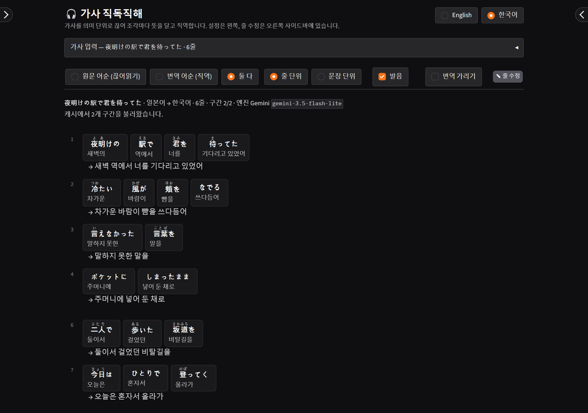
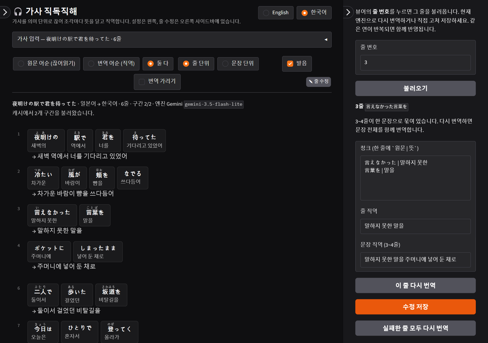
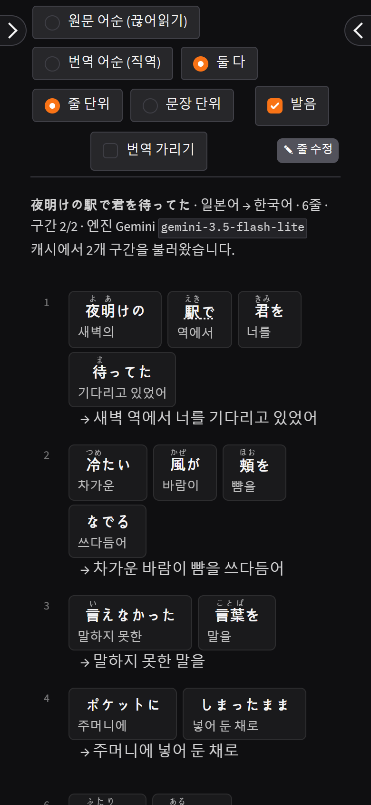

# 🎧 가사 직독직해 (Lyrics Chunk Reader)

[English](README.md) | **한국어**

노래 가사를 **의미 단위로 끊어 조각마다 뜻을 달고, 번역 언어 어순으로 직역**해 주는 언어 학습용 로컬 웹 앱입니다.
로컬 LLM(Ollama)이나 무료 API(Gemini, Groq 등)로 동작하고, 화면은 한국어·영어를 지원합니다.



> 스크린샷의 가사는 데모용으로 직접 지은 예문입니다.

## 주요 기능

- **끊어읽기 + 직역**: 원문 어순 그대로 조각마다 뜻을 달고(끊어읽기), 줄 또는 여러 줄에 걸친 문장 단위로 직역합니다.
- **주요 언어 지원**: 원문·번역 언어를 영어·일본어·중국어·한국어·스페인어·프랑스어·독일어·포르투갈어·이탈리아어·러시아어·베트남어·태국어·인도네시아어 중에서 고릅니다. 원문 언어는 자동 감지됩니다.
- **발음 표기**: 일본어 후리가나, 중국어 병음 (LLM 없이 로컬 분석기로).
- **사전 링크**: 조각을 누르면 네이버 사전 또는 Jisho·MDBG·Wiktionary가 열립니다.
- **가사 자동 정리**: `[Chorus]`·LRC 타임스탬프·크레딧·가사 사이트 잔여물을 지우고, .txt/.lrc 파일을 인코딩을 추정해 엽니다.
- **줄 수정**: 줄 번호를 눌러 그 줄만 다시 번역하거나 직접 고칩니다. 반복되는 후렴에 함께 반영됩니다.
- **캐시·최근 번역**: 한 번 번역한 곡은 다시 열면 바로 나옵니다.
- **내보내기**: Markdown(복습용), 인쇄용 HTML(PDF 저장), JSON.
- **폰에서도**: 같은 와이파이에서 폰 브라우저로 접속해 쓸 수 있습니다.

## 빠른 시작

Python 3.10 이상이 필요합니다.

### Windows (PowerShell)

```powershell
py -m venv .venv
.\.venv\Scripts\python.exe -m pip install -r requirements.txt
.\.venv\Scripts\python.exe app.py
```

### macOS / Linux

```bash
python3 -m venv .venv
source .venv/bin/activate
python -m pip install -r requirements.txt
python app.py
```

브라우저에서 http://127.0.0.1:7860 을 엽니다. 일본어 발음 사전(unidic-lite) 때문에 설치에 약 250MB가 필요합니다.

API 키나 기본 엔진은 `.env.example`을 `.env`로 복사해 필요한 값만 채우면 됩니다(선택). Windows에서는 설치 후 `start.bat`을 더블클릭하면 Ollama 서버와 앱을 띄우고 브라우저를 엽니다(`qwen3:8b`가 없으면 처음에 약 5.2GB를 받습니다).

## 번역 엔진

| 엔진 | 특징 | 설정 |
|---|---|---|
| **Ollama** (로컬) | 가사가 PC 밖으로 나가지 않고 거부가 거의 없음. GPU 성능에 따라 느릴 수 있음 | [ollama.com](https://ollama.com) 설치 후 `ollama pull qwen3:8b` |
| **Gemini** (무료 API) | 빠르고 정확함. 기본 모델 `gemini-3.5-flash-lite`, 더 자연스러운 끊어읽기는 `gemini-3.6-flash` | [Google AI Studio](https://aistudio.google.com)에서 키 발급 → `.env`의 `GEMINI_API_KEY` |
| **OpenAI 호환** | Groq·OpenRouter·LM Studio 등 `/chat/completions` 지원 서비스 | `OPENAI_BASE_URL`, `OPENAI_API_KEY`, `OPENAI_MODEL` |

- 기본 엔진은 `.env`의 `LYRICS_BACKEND`(ollama | gemini | openai)로 정하고, 화면 왼쪽 **설정 → 엔진**에서 바꿀 수 있습니다.
- **어떤 엔진을 쓸까?** VRAM 4GB 노트북 GPU에서 `qwen3:8b`는 일부가 CPU로 넘어가 4줄 연 하나에 약 40초가 걸렸고, Gemini는 2~7초였습니다. VRAM이 8GB 미만이면 Gemini를 주 엔진으로, Ollama를 **보조 엔진**(실패한 줄만 다시 시도)으로 두는 구성을 권장합니다.
- 무료 API의 한도와 모델 이름은 수시로 바뀝니다. **연결 확인** 버튼으로 키·모델을 확인하고 쓸 수 있는 모델 목록을 불러올 수 있습니다.

## 사용법

1. 가사를 붙여넣거나 **파일**(.txt/.lrc)을 열고, 원문 언어(기본 자동 감지)와 번역 언어(→ 한국어 등)를 고른 뒤 **번역** (Ctrl/Cmd+Enter).
   - 입력 칸은 번역을 시작하면 접히고, 연이 하나씩 끝날 때마다 뷰어가 채워집니다.
   - 오래 걸리면 **중단**. 끝난 부분은 남고, 다시 번역하면 캐시 덕분에 나머지만 번역합니다.
2. 뷰어 툴바에서 보기 방식을 바로 바꿉니다(재번역 없음).

   | 원문 어순 (끊어읽기) | 번역 어순 (직역) |
   |---|---|
   | `I've been waiting / for you / all night`<br>`나는 기다려 왔어 / 너를 / 밤새` | `I've been waiting for you all night`<br>`→ 나는 밤새 너를 기다려 왔어` |

   - **둘 다**: 끊어읽기 카드 아래에 직역을 함께 보여 줍니다.
   - **줄 단위 / 문장 단위**: 여러 줄에 걸친 문장을 묶어 한 번에 직역할 수 있습니다.
   - **발음**, **번역 가리기**(흐리게 가렸다가 누르면 보임 — 셀프 테스트용).
3. 마음에 안 드는 줄은 **줄 번호를 눌러** 오른쪽 **줄 수정** 패널에서 다시 번역하거나 `원문 | 뜻` 형식으로 직접 고칩니다.

   

4. 결과는 **설정 → 내보내기**에서 Markdown·인쇄용 HTML·JSON으로 받습니다. 지난 곡은 **설정 → 최근 번역**에서 바로 다시 엽니다.

화면 언어(English / 한국어)는 오른쪽 위 버튼으로 바꿉니다. 처음에는 브라우저 언어를 따릅니다. 엔진·모델·보기 설정은 브라우저에 기억됩니다(API 키는 저장하지 않으니 `.env`에 넣으세요).

## 설정 팁

- **보조 엔진**: 주 엔진에서 실패한 줄만 다른 엔진으로 자동 재시도합니다. 보조 엔진의 키·주소는 `.env` 값을 씁니다.
- **요청 실패 시 재시도 횟수**(기본 3): 연결 끊김·시간 초과·한도 초과(429)·서버 과부하(5xx)이면 서버가 알려 준 시간(없으면 2·4·8…초, 최대 30초)만큼 기다렸다가 다시 요청합니다. 1분 넘게 기다리라는 응답과 400·401 같은 잘못된 요청은 바로 오류로 표시합니다.
- **한 번에 보낼 최대 줄 수**(기본 8): 연이 이보다 길면 나눠 보냅니다. 작을수록 거부가 줄고, 클수록 빠릅니다.
- **청크 사전 링크**(설정 → 표시): 네이버 사전은 일·중·영·한, 그 밖의 언어는 Wiktionary로 연결합니다. 누를 때만 그 조각이 사전 사이트로 전송됩니다.

## 폰에서 쓰기

PC에서 `HOST=0.0.0.0 python app.py`로 실행하고(PowerShell은 `$env:HOST = "0.0.0.0"` 후 `.venv\Scripts\python.exe app.py`), 같은 와이파이의 폰 브라우저에서 `http://<PC의 IP>:7860`을 엽니다. 같은 네트워크의 누구나 접속할 수 있으니 공용 와이파이에서는 쓰지 마세요.



## 캐시

- 위치: `~/.lyrics-jikdok/cache.db` (환경변수 `LYRICS_CACHE`로 변경)
- 키: 엔진·모델·원문 언어·번역 언어·연 원문. 하나라도 바뀌면 새로 번역합니다.
- 반복되는 연(후렴)은 한 번만 번역하고, 수정하면 반복되는 곳에 함께 반영됩니다. 실패한 줄이 있는 연은 저장하지 않아 다음에 다시 시도됩니다.
- 새로 번역하려면 **캐시 무시**, 전부 지우려면 **설정 → 엔진 → 캐시 비우기**.

## 거부·실패를 줄이는 장치

- 프롬프트를 "번역"이 아닌 **학습용 문법 주석** 작업으로 정의하고, 원문 재작성은 금지합니다.
- 연 단위로 보내고, 앞뒤 연의 몇 줄을 **문맥**으로 함께 줍니다.
- 연 전체가 거부되면 **반씩 나눠** 다시 보내 거부되는 줄만 고립시키고, 남은 줄은 **1줄씩** 재시도합니다. 그 과정에서 끊긴 문장은 거부 줄을 뺀 채 다시 묶어 문장 직역을 되살립니다.
- 조각을 이었을 때 원문과 80% 이상 일치하지 않으면 버립니다(환각 방지).
- Gemini의 저작물 재현 필터(RECITATION)에 걸려도 위 분할 재시도로 대부분 통과합니다. 그래도 실패한 줄은 ⚠와 이유를 보여 주니 줄 수정 패널에서 다른 엔진으로 다시 번역하세요.

## 구조

```
app.py                  Gradio 웹 UI (화면 문구는 lyrics_tool/i18n.py)
lyrics_tool/
  backends.py           Ollama / Gemini / OpenAI 호환 엔진, 재시도
  core.py               연 단위 구간, 프롬프트, 분할 재시도, 문장 묶음, 재번역·수정
  langs.py              지원 언어 목록, 원문 언어 자동 감지
  i18n.py               화면·메시지 문구 (영어·한국어)
  cache.py              SQLite 번역 캐시 + 최근 번역 목록
  cleanup.py            가사 자동 정리, TXT/LRC 인코딩 추정 읽기
  reading.py            발음 표기(후리가나·병음), 사전 링크
  render.py             보기 방식·직역 단위별 HTML·Markdown 렌더링
tests/                  가짜 엔진 기반 테스트 (python -m pytest)
start.bat               Windows 실행 스크립트 (Ollama 확인 → 앱 실행 → 브라우저)
```

테스트: `python -m pip install pytest` 후 `python -m pytest`.

## 참고

입력한 가사는 개인 학습용으로만 사용하세요. 번역 결과를 공개할 때는 원저작물의 권리를 확인해야 합니다. API 엔진을 쓰면 가사가 그 서비스로 전송됩니다.

## 라이선스

[MIT](LICENSE) © 2026 Devleu
