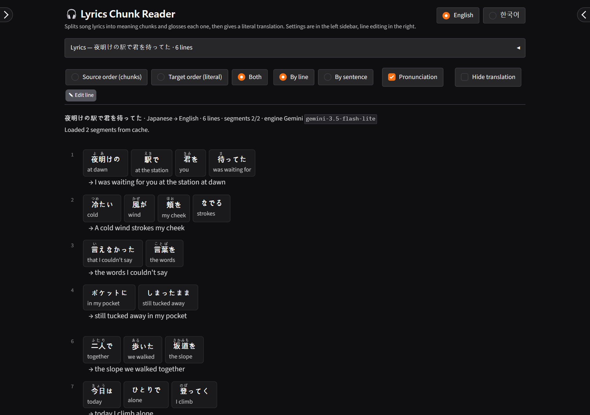
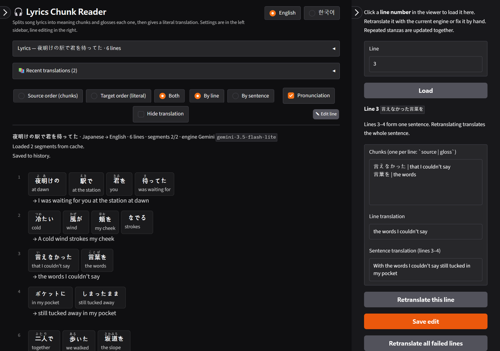
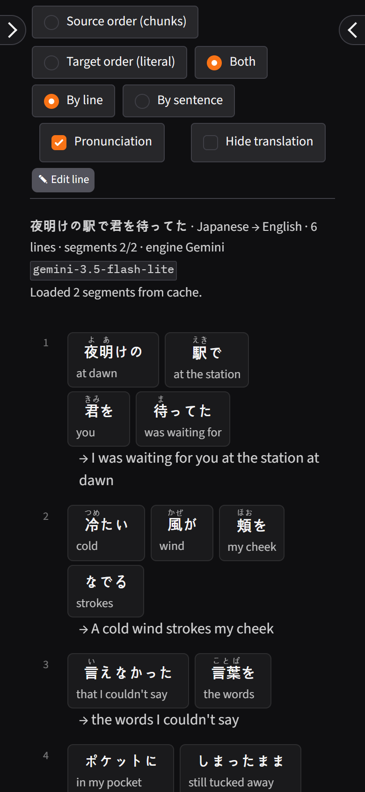
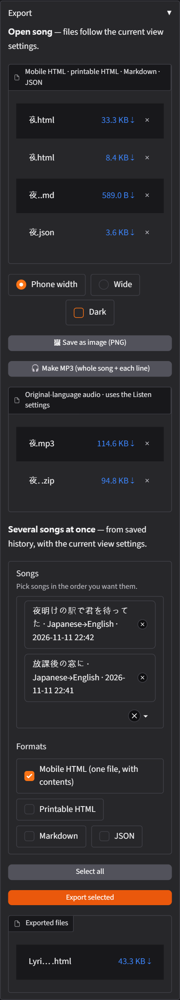
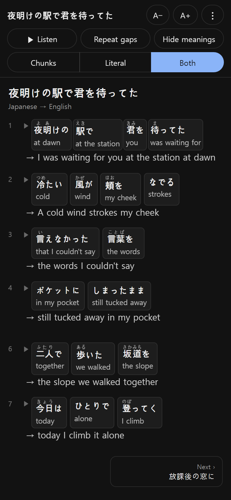
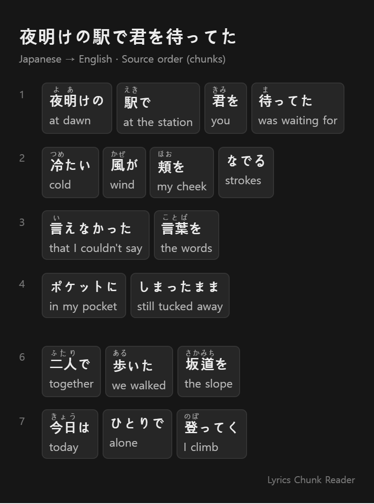
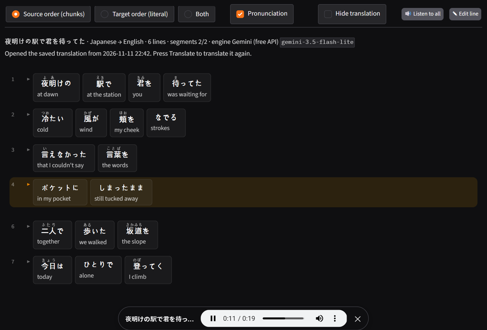
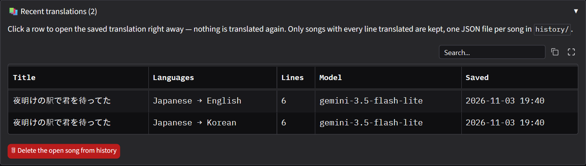

# 🎧 Lyrics Chunk Reader

**English** | [한국어](README.ko.md)

A local web app for language learners that **splits song lyrics into meaning chunks, glosses each chunk, and gives a literal translation in the target language's word order**.
It runs on a local LLM (Ollama) or a free API (Gemini, Groq, …), and the interface is available in English and Korean.



> The lyrics in the screenshots are original sample lines written for this demo.

## Features

- **Chunked reading + literal translation**: glosses each chunk in the original word order, then translates each line — or each multi-line sentence — literally.
- **Major languages**: pick the source and target from English, Japanese, Chinese, Korean, Spanish, French, German, Portuguese, Italian, Russian, Vietnamese, Thai and Indonesian. The source language is auto-detected.
- **Pronunciation**: furigana for Japanese, pinyin for Chinese (local analyzers, no LLM).
- **Listen in the original language**: hear a chunk, a line (▶) or the whole song read by natural neural voices, slowed down if you like, with pauses to repeat after it; export it as MP3 (whole song + one file per line). See [Listen](#listen). Middle-click a chunk opens Naver Dictionary or Jisho · MDBG · Wiktionary.
- **Lyrics clean-up**: strips `[Chorus]` labels, LRC timestamps, credits and lyrics-site leftovers; opens .txt/.lrc files with encoding detection.
- **Line editing**: click a line number to retranslate just that line or fix it by hand. Repeated choruses update together.
- **History**: every fully translated song is kept in a list on the main screen — click it to reopen instantly, without translating again. Songs still open in a tab even after the app server stops.
- **Export**: mobile HTML (easy reading on a phone), printable HTML (save as PDF), Markdown, JSON, and a PNG image of the view. Several saved songs can be exported at once (see [Export](#export)).
- **Works on your phone** over the same Wi-Fi.

## Quick start

Requires Python 3.10+.

### Windows (PowerShell)

```powershell
py -m venv .venv
.\.venv\Scripts\python.exe -m pip install -r requirements.txt
.\.venv\Scripts\python.exe app.py
```

### macOS / Linux

```bash
python3 -m venv .venv
source .venv/bin/activate
python -m pip install -r requirements.txt
python app.py
```

Open http://127.0.0.1:7860. The install needs about 250 MB, mostly for the Japanese pronunciation dictionary (unidic-lite).

For API keys or a default engine, copy `.env.example` to `.env` and fill in what you need (optional). On Windows, after installing you can double-click `start.bat`: it starts the Ollama server and the app, then opens the browser (it downloads `qwen3:8b`, about 5.2 GB, on first run if missing).

## Translation engines

| Engine | Notes | Setup |
|---|---|---|
| **Ollama** (local) | Lyrics never leave your PC; almost no refusals. Speed depends on your GPU | Install from [ollama.com](https://ollama.com), then `ollama pull qwen3:8b` |
| **Gemini** (free API) | Fast and accurate. Default `gemini-3.5-flash-lite`; `gemini-3.6-flash` for more natural chunks | Get a key at [Google AI Studio](https://aistudio.google.com) → `GEMINI_API_KEY` in `.env` |
| **OpenAI-compatible** | Groq, OpenRouter, LM Studio, or anything with `/chat/completions` | `OPENAI_BASE_URL`, `OPENAI_API_KEY`, `OPENAI_MODEL` |

- Set the default engine with `LYRICS_BACKEND` (ollama | gemini | openai) in `.env`, or change it under **Settings → Engine** in the left sidebar.
- **Which engine?** On a laptop GPU with 4 GB of VRAM, `qwen3:8b` spilled onto the CPU and took about 40 s per 4-line stanza, while Gemini took 2–7 s. With less than 8 GB of VRAM, use Gemini as the main engine and Ollama as the **fallback engine** (it retries only the failed lines).
- Free-tier limits and model names change often. **Test connection** checks your key and model and loads the list of available models.

## How to use

1. Paste lyrics or open a **file** (.txt/.lrc), choose the source language (auto-detect by default) and the target (→ English, …), then press **Translate** (Ctrl/Cmd+Enter).
   - The input panel collapses when translation starts, and the viewer fills in stanza by stanza.
   - Press **Stop** if it takes too long. Finished parts are kept, and translating again only sends the rest thanks to the cache.
2. Switch views from the viewer toolbar (no retranslation).

   | Source order (chunks) | Target order (literal) |
   |---|---|
   | `君に / 会いたくて`<br>`to you / wanting to see` | `君に会いたくて`<br>`→ wanting to see you` |

   - **Both**: shows the literal translation under the chunk cards.
   - **By line / By sentence**: translate sentences that span several lines in one piece.
   - **Pronunciation**, **Hide translation** (blurred until you tap it — for self-testing).
3. If a line looks wrong, **click its line number** to open the **Edit line** panel on the right. Retranslate it, or fix it by hand as `source | gloss`.

   

4. Download results under **Settings → Export** — as files, as an image, or several songs at once (see [Export](#export)). Reopen past songs from **📚 Recent translations** below the lyrics box (see [History](#history)).

Switch the interface language (English / 한국어) with the buttons at the top right. It starts in your browser's language. Engine, model and view settings are remembered in the browser and survive app restarts (API keys are never saved, so put them in `.env`). The settings are encrypted with a key kept in `~/.lyrics-jikdok/settings.key`; deleting it resets them to the defaults.

## Settings tips

- **Fallback engine**: automatically retries only the lines the main engine failed, with another engine. It uses keys/addresses from `.env`.
- **Retries on request failure** (default 3): on dropped connections, timeouts, rate limits (429) or overload (5xx), waits as long as the server asks (otherwise 2·4·8… s, up to 30 s) and retries. A request to wait more than a minute, or a bad request such as 400/401, is shown as an error right away.
- **Max lines per request** (default 8): longer stanzas are split. Smaller means fewer refusals, larger means faster.
- **Dictionary links** (Settings → Display): clicking a chunk reads it aloud (see [Listen](#listen)). Middle-click or Ctrl+click opens the dictionary: Naver covers Japanese, Chinese, English and Korean; other languages go to Wiktionary. A chunk is sent to the dictionary site only when you click it.

## Use it on your phone

Run `HOST=0.0.0.0 python app.py` on your PC (PowerShell: `$env:HOST = "0.0.0.0"` then `.venv\Scripts\python.exe app.py`) and open `http://<your PC's IP>:7860` in your phone's browser on the same Wi-Fi. Anyone on the network can connect, so don't do this on public Wi-Fi.



## Export

Under **Settings → Export**. Every file follows the current view settings (view mode, literal unit, pronunciation, line numbers).

- **Open song**: mobile HTML · printable HTML · Markdown · JSON are ready to download as soon as a song is shown.
- **🖼 Save as image (PNG)**: draws the open song as one long image, at phone width or wide, light or dark. Your browser draws it with its own fonts (no extra libraries, works offline), so pronunciation and chunk cards look like the screen. Hidden translations are shown in the image.
- **Mobile HTML**: one self-contained file for reading on a phone. A bar at the top switches between chunks / literal / both, hides meanings for self-testing (tap a meaning to peek), and changes the text size; your choices are remembered on that phone. Each lyric line stays on one row: long lines get tighter and smaller, and only lines that would drop below 60% wrap (a chunk longer than the screen wraps inside its card, so the page never scrolls sideways). Tap a chunk or a line's ▶ to hear it, or **▶ Listen** to read the song line by line (**Repeat gaps** leaves time to repeat each line) — this uses the phone's own voices. Long-press a chunk to open the dictionary link. Follows the phone's dark mode.
- **🎧 Make MP3**: the open song read in the original language — one MP3 of the whole song and a ZIP with one MP3 per line (`01_first words.mp3` …), using the Listen settings.
- **Several songs at once**: pick songs from your saved history (in the order you want, or **Select all**) and the formats. Mobile HTML puts every song into one file with a table of contents — it folds up once you pick a song, and **↑ Contents** at the end of each song (or the title in the top bar) opens it again; the other formats go into a ZIP with one folder per song. Songs are exported as saved — nothing is translated again.

  

## Listen

Hear the **original lyrics** to compare your pronunciation.

- **Chunk**: click its text. **Line**: click ▶ next to the line number. **Whole song**: **🔊 Listen to all** in the toolbar opens a player at the bottom and highlights the line being read.
- **Settings → 🔊 Listen**: female / male voice, speed (0.5–1.5×), and the pause between lines for the whole song — short, 1.5 s, or **time to repeat** (as long as the line itself, plus half a second).
- Voices: Microsoft Edge's online neural voices via [edge-tts](https://github.com/rany2/edge-tts) (`pip install edge-tts`, included in `requirements.txt`). The original lyrics are sent to Microsoft and an internet connection is needed. Each line is made once and cached, so replays are instant (the first whole song takes several seconds).
- The mobile HTML can't call the app, so there it reads with the phone's own voices.



## History

- The **📚 Recent translations** list under the lyrics box loads by itself when the page opens and refreshes after each translation.
- Click a row to open that song **as saved** — no engine is called and nothing is translated again. Press **Translate** if you do want a fresh translation.
- Only songs with **every line translated** are saved. Stopped translations or songs with failed lines are not; once you fix the failed lines (Edit line), the song is saved.
- Storage: one JSON file per song in the `history/` folder of the project (override with `LYRICS_HISTORY_DIR`). The same lyrics in the same target language overwrite the earlier file. You can open, back up or delete the files directly; **🗑 Delete the open song from history** removes the open one.
- **When the app is off**: the open tab keeps a copy of every saved song (only changed songs are sent again). If the server stops, clicking a row still shows the song from that copy, with a notice to restart the app before editing or translating.



- History from earlier versions (kept in the cache DB) is moved into `history/` on first start, but only for songs whose results are complete.

## Cache

- Location: `~/.lyrics-jikdok/cache.db` (override with `LYRICS_CACHE`). It stores translated stanzas so repeated stanzas and retries don't call the engine again; your song list lives in `history/` (above).
- Key: engine, model, source language, target language and stanza text. Change any of them and it translates again.
- Repeated stanzas (choruses) are translated once, and edits apply to every repeat. Stanzas with failed lines aren't cached, so they are retried next time.
- Use **Ignore cache** to translate fresh, or **Settings → Engine → Clear cache** to wipe it.

## How it reduces refusals and failures

- The prompt frames the job as **grammar annotation for a learner**, not translation, and forbids rewriting the text.
- Lyrics are sent stanza by stanza, with a few lines of the neighbouring stanzas as **context**.
- If a whole stanza is refused, it is **split in half** and resent to isolate the refused lines; the rest are retried **one line at a time**. Sentences cut apart along the way are regrouped (without the refused lines) to recover the sentence translation.
- Responses whose chunks don't rebuild at least 80% of the original line are discarded (hallucination guard).
- Gemini's recitation filter (RECITATION) is usually passed by this splitting. Lines that still fail show ⚠ with the reason — retranslate them with another engine in the Edit line panel.

## Project layout

```
app.py                  Gradio web UI (all strings in lyrics_tool/i18n.py)
lyrics_tool/
  backends.py           Ollama / Gemini / OpenAI-compatible engines, retries
  core.py               stanza segments, prompt, split-and-retry, sentence groups, retranslate/edit
  langs.py              supported languages, source-language detection
  i18n.py               UI and message strings (English, Korean)
  cache.py              SQLite translation cache (per stanza)
  history.py            translation history, one JSON file per song in history/
  cleanup.py            lyrics clean-up, TXT/LRC reading with encoding detection
  reading.py            pronunciation (furigana, pinyin), dictionary links
  render.py             HTML/Markdown rendering per view mode and unit (screen, print, mobile, image)
  export.py             export files for one song or several (ZIP, mobile book)
  speech.py             original-language audio (edge-tts), MP3 joining, per-line timings
tests/                  tests with a fake engine (python -m pytest)
start.bat               Windows launcher (checks Ollama → starts the app → opens the browser)
```

Tests: `python -m pip install pytest`, then `python -m pytest`.

## Notes

Use the lyrics you enter for personal study only, and check the rights to the original work before publishing any translation. API engines send the lyrics to that service.

## License

[MIT](LICENSE) © 2026 Devleu
